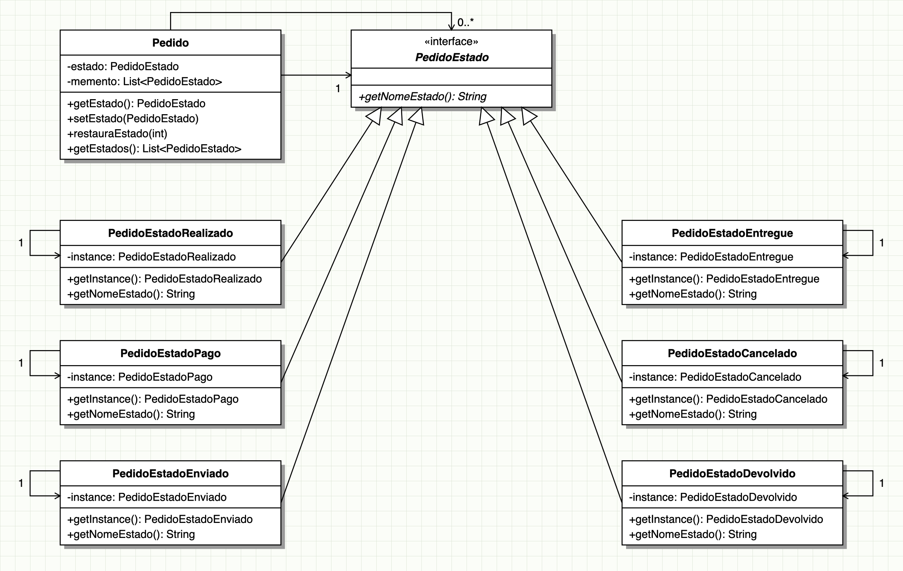

# Memento: Histórico de Pedido

Implementação do padrão de projeto **Memento**, aplicada ao histórico de estados de um pedido de compra.

## Diagrama UML



Versão editável em Mermaid: [docs/diagrama-uml.md](docs/diagrama-uml.md).

## Como rodar os testes

```
mvn test
```
